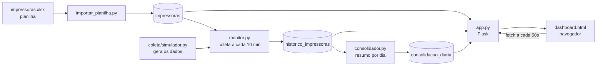

# Projeto Impressoras

Sistema web para **monitorar as impressoras de uma empresa**: mostra quais estão online ou offline, o nível dos suprimentos (toner e unidade de imagem) e uma análise do consumo ao longo do tempo.

Desenvolvido como Projeto Integrador (PI).

> **Aviso:** nesta versão os dados das impressoras são **simulados** pelo arquivo `coleta/simulador.py`. O cadastro (local, modelo, IP) vem de uma planilha real de exemplo, mas os níveis de toner e o status de rede são gerados pelo sistema. A coleta real via rede é uma evolução futura.

---

## Tecnologias

| Camada | Tecnologia |
|---|---|
| Linguagem | Python 3 |
| Framework web | Flask |
| Banco de dados | SQLite |
| Leitura da planilha / análise | pandas + openpyxl |
| Interface | HTML, CSS e JavaScript (sem bibliotecas externas) |
| Controle de versão | Git + GitHub |

---

## Como funciona



1. **Cadastro:** a planilha `impressoras.xlsx` lista as impressoras ativas (local, modelo, tipo, papel, nº de série e IP). O `importar_planilha.py` copia esse cadastro para a tabela `impressoras` do banco, que é de onde o resto do sistema lê.
2. **Coleta:** o `monitor.py` roda sem parar. A cada 10 minutos lê o cadastro no banco, pede ao simulador os dados de cada impressora e grava uma medição no banco.
3. **Consolidação:** o `consolidador.py` agrupa as medições por dia e por impressora, calculando consumo médio, tempo online/offline e alertas.
4. **Visualização:** o `app.py` junta tudo e entrega o dashboard, que tem duas abas: **Monitoramento** (situação atual) e **Análise** (histórico consolidado).

### Regras de classificação dos suprimentos

| Nível | Classificação |
|---|---|
| até 5% | Crítico |
| até 20% | Atenção |
| acima de 20% | Normal |

A impressora recebe o pior status entre seus suprimentos.

---

## Estrutura do projeto

```
Projeto-Impressoras/
├── app.py                  # Servidor web (Flask) e rota do dashboard
├── config.py               # Caminhos, intervalos e configurações do servidor
├── banco.py                # Conexão, criação das tabelas e consultas SQL
├── planilha.py             # Leitura do cadastro de impressoras no Excel
├── importar_planilha.py    # Copia o cadastro da planilha para o banco
├── monitor.py              # Coleta periódica e gravação no banco
├── coleta/
│   ├── __init__.py
│   └── simulador.py        # Gera níveis de toner e status de rede
├── consolidador.py         # Resumo diário do histórico
├── impressoras.xlsx        # Cadastro das impressoras
├── templates/
│   └── dashboard.html      # Estrutura da página (HTML)
├── static/
│   ├── css/
│   │   └── dashboard.css   # Estilos do dashboard
│   └── js/
│       └── dashboard.js    # Comportamento da página (JavaScript)
├── teste_banco.py          # Verificação manual do banco
├── teste_consolidacao.py   # Verificação manual da tabela de consolidação
├── teste_contagem.py       # Confere a contagem de status
├── teste_rede.py           # Testa conexão com impressoras reais pela rede
└── requirements.txt        # Bibliotecas necessárias
```

Arquivos gerados ao rodar (não vão para o Git): `impressoras.db`, `estado_simulacao.json` e a pasta `venv/`.

---

## Como executar

Pré-requisito: [Python 3](https://www.python.org/downloads/) instalado.

Os comandos abaixo são para **Windows** (PowerShell ou terminal do VS Code), executados na pasta do projeto.

**1. Criar o ambiente virtual e instalar as bibliotecas** (só na primeira vez)

```powershell
python -m venv venv
venv\Scripts\python -m pip install -r requirements.txt
```

**2. Importar o cadastro das impressoras** (na primeira vez e sempre que a planilha for alterada)

```powershell
venv\Scripts\python importar_planilha.py
```

**3. Iniciar a coleta** (deixe este terminal aberto)

```powershell
venv\Scripts\python monitor.py
```

**4. Gerar a consolidação** (em outro terminal, depois de algumas coletas)

```powershell
venv\Scripts\python consolidador.py
```

**5. Abrir o dashboard** (em outro terminal)

```powershell
venv\Scripts\python app.py
```

Acesse **http://127.0.0.1:5000** no navegador. Para encerrar qualquer um dos programas, use `Ctrl + C`.

> Em Linux ou macOS, troque `venv\Scripts\python` por `venv/bin/python`.

---

## Banco de dados

### `impressoras`

Cadastro das impressoras, copiado da planilha pelo `importar_planilha.py`. É substituído inteiro a cada importação; o histórico de medições não é alterado.

| Coluna | Descrição |
|---|---|
| `id` | Identificador (mantém a ordem da planilha) |
| `local`, `modelo`, `tipo`, `paper`, `serie` | Dados da planilha |
| `ip` | Endereço da impressora (não pode se repetir) |

### `historico_impressoras`

Uma linha por medição de cada impressora.

| Coluna | Descrição |
|---|---|
| `id` | Identificador |
| `data_hora` | Momento da medição |
| `local`, `modelo`, `tipo`, `paper`, `serie`, `ip` | Dados do cadastro |
| `status_rede` | `online` ou `offline` |
| `status_geral` | `normal`, `atencao` ou `critico` |
| `suprimentos` | JSON com o percentual de cada suprimento |
| `status_suprimentos` | JSON com a classificação de cada suprimento |

### `consolidacao_diaria`

Uma linha por impressora por dia.

| Coluna | Descrição |
|---|---|
| `data` | Dia consolidado |
| `local`, `ip`, `modelo` | Identificação da impressora |
| `total_medicoes` | Quantidade de medições no dia |
| `online`, `offline` | Quantas medições em cada estado |
| `criticas`, `atencoes`, `normais` | Quantas medições em cada status |
| `consumo_medio` | Queda média dos suprimentos entre medições (%) |
| `ultima_medicao` | Horário da última medição do dia |

---

## API

O sistema oferece duas rotas que devolvem os dados em **JSON**. São elas que alimentam o dashboard: o JavaScript da página consulta essas rotas a cada 50 segundos e atualiza os valores na tela, sem recarregar a página.

Com o servidor rodando, dá para abrir as duas direto no navegador.

### `GET /api/impressoras`

Situação atual de todas as impressoras: o cadastro somado à última medição de cada uma.

```json
{
  "atualizado_em": "2026-10-19 09:56:18",
  "resumo": {
    "total": 48,
    "online": 45,
    "offline": 3,
    "atencao": 11,
    "criticas": 6
  },
  "impressoras": [
    {
      "local": "Diretoria",
      "modelo": "CX950",
      "tipo": "COLOR",
      "paper": "A3 / A4",
      "serie": "0123ABCD0123",
      "ip": "192.168.0.2",
      "status_rede": "online",
      "status_geral": "atencao",
      "suprimentos": {
        "toner_preto": 54,
        "toner_ciano": 18,
        "toner_magenta": 72,
        "toner_amarelo": 61,
        "unidade_imagem": 88
      },
      "status_suprimentos": {
        "toner_preto": "normal",
        "toner_ciano": "atencao",
        "toner_magenta": "normal",
        "toner_amarelo": "normal",
        "unidade_imagem": "normal"
      },
      "data_hora": "2026-10-19 09:56:18"
    }
  ]
}
```

| Campo | Descrição |
|---|---|
| `atualizado_em` | Data e hora da medição mais recente, ou `null` se ainda não houver nenhuma |
| `resumo` | Contadores prontos, iguais aos exibidos no topo do dashboard |
| `impressoras` | Uma entrada por impressora cadastrada, na ordem da planilha |
| `status_rede` | `online`, `offline` ou `desconhecido` (quando a impressora ainda não foi medida) |
| `status_geral` | `normal`, `atencao` ou `critico` (o pior status entre os suprimentos) |
| `suprimentos` | Percentual de cada suprimento |
| `status_suprimentos` | Classificação de cada suprimento |

### `GET /api/analise`

Dados consolidados do histórico, usados na aba Análise.

```json
{
  "total_registros": 96,
  "consumo_medio": 2.336805555555556,
  "total_criticas": 24,
  "total_atencoes": 11,
  "total_normais": 67,
  "total_online": 93,
  "total_offline": 3,
  "setores": [
    { "local": "Carregamento", "consumo": 5.5 }
  ],
  "top_impressoras": [
    {
      "local": "Carregamento",
      "ip": "192.168.0.45",
      "modelo": "MS812",
      "consumo": 5.5,
      "medicoes": 2
    }
  ],
  "evolucao": [
    { "data": "2026-10-19", "consumo": 2.34 }
  ]
}
```

| Campo | Descrição |
|---|---|
| `total_registros` | Linhas na consolidação (uma por impressora em cada dia) |
| `consumo_medio` | Queda média dos suprimentos entre medições, em pontos percentuais |
| `total_criticas`, `total_atencoes`, `total_normais` | Quantidade de **medições** em cada status no período |
| `total_online`, `total_offline` | Quantidade de **medições** em cada estado de rede |
| `setores` | Consumo médio por local, do maior para o menor |
| `top_impressoras` | As 10 impressoras de maior consumo |
| `evolucao` | Consumo médio de cada dia |

> Os totais desta rota contam **medições do período inteiro**, não impressoras. Para saber quantas impressoras estão críticas agora, use o `resumo` de `/api/impressoras`.

### Observações

- As duas rotas respondem apenas a `GET` e não exigem autenticação, por rodarem na rede interna.
- As datas seguem o formato `AAAA-MM-DD HH:MM:SS`.
- Os números vêm sem arredondamento; quem exibe decide como formatar.
- Se a planilha ainda não tiver sido importada, `/api/impressoras` devolve a lista vazia e o resumo zerado.

---

## Requisitos do PI

| Requisito | Situação | Onde está |
|---|---|---|
| Framework web | Concluído | Flask (`app.py`) |
| Banco de dados | Concluído | SQLite (`banco.py`) |
| Script web (JavaScript) | Concluído | `static/js/dashboard.js` |
| Controle de versão | Concluído | Git + GitHub |
| Análise de dados (opcional) | Concluído | pandas + `consolidador.py` + aba Análise |
| Testes | Em andamento | Existem verificações manuais; faltam testes automatizados |
| Uso de API | Concluído | Rotas `/api/impressoras` e `/api/analise` (`app.py`) |
| Acessibilidade | Pendente | Etapa 5 |
| Nuvem | Pendente | Etapa 6 |

---

## Tarefas

### Etapa 1 — Base do sistema

- [x] Cadastro das impressoras em planilha
- [x] Simulador de suprimentos e status de rede
- [x] Monitor com coleta periódica
- [x] Banco de dados SQLite com histórico das medições
- [x] Servidor web com Flask
- [x] Dashboard com JavaScript (abas, filtros, detalhes, atualização automática)
- [x] Consolidação diária e aba de análise de dados
- [x] Repositório Git publicado no GitHub

### Etapa 2 — Organização e correções

- [x] Corrigir pasta duplicada do projeto
- [x] Criar `requirements.txt`
- [x] Criar README com instruções e tarefas
- [x] Remover marcações ` ``` ` que sobraram no `dashboard.html` e aparecem na página
- [x] Criar `config.py` com caminhos e intervalos (hoje `"impressoras.db"` está repetido em 5 arquivos)
- [x] Criar `banco.py` com conexão, criação das tabelas e consultas, eliminando o SQL repetido
- [x] Unificar a leitura da planilha (hoje duplicada em `app.py` e `monitor.py`)
- [x] Criar `importar_planilha.py` para levar o Excel a uma tabela `impressoras` e usar o banco como fonte do cadastro
- [x] Mover o simulador para a pasta `coleta/` com uma função única `coletar(impressora)`, identificando a impressora pelo IP em vez da posição na planilha
- [x] Revisar os totais da aba Análise (os rótulos deixam claro que são medições do período, não impressoras)
- [ ] Remover código não utilizado (`converter_data` no `consolidador.py`)

### Etapa 3 — API

- [x] Separar o CSS do dashboard em `static/css/dashboard.css`
- [x] Separar o JavaScript do dashboard em `static/js/dashboard.js`
- [x] Criar rota `GET /api/impressoras` retornando JSON
- [x] Criar rota `GET /api/analise` retornando JSON
- [x] Fazer o JavaScript buscar os dados na API (`fetch`) em vez de lê-los embutidos no HTML
- [x] Atualizar só os dados na tela, sem recarregar a página inteira a cada 50 segundos
- [x] Documentar as rotas da API neste README

### Etapa 4 — Testes automatizados

- [ ] Configurar o pytest e criar a pasta `tests/`
- [ ] Testar a classificação dos suprimentos (`classificar_nivel`)
- [ ] Testar o cálculo de consumo (`calcular_consumo`)
- [ ] Testar as funções de `banco.py`
- [ ] Testar as rotas da API e do dashboard
- [ ] Usar banco de dados temporário nos testes
- [ ] Substituir os scripts `teste_*.py` de verificação manual pelos testes automatizados
- [ ] Documentar como rodar os testes

### Etapa 5 — Acessibilidade

- [ ] Rótulos para leitores de tela (`aria-label`, `role`)
- [ ] Navegação por teclado nos cards e nos filtros
- [ ] Foco correto ao abrir e fechar a janela de detalhes
- [ ] Status indicado também por texto ou ícone, não só por cor
- [ ] Conferir o contraste das cores
- [ ] Validar com Lighthouse ou WAVE e registrar o resultado

### Etapa 6 — Nuvem

- [ ] Alterar o `monitor.py` para executar uma coleta e terminar (manter o modo contínuo como opção para uso local)
- [ ] Executar o consolidador automaticamente após cada coleta
- [ ] Ajustar configurações para produção (desligar `debug`)
- [ ] Publicar no PythonAnywhere (mantém os arquivos, então o SQLite funciona, e oferece tarefas agendadas)
- [ ] Agendar a coleta no servidor
- [ ] Adicionar o link do sistema publicado neste README

### Etapa 7 — Entrega

- [ ] Adicionar capturas de tela do dashboard
- [ ] Revisar a documentação final
- [ ] Preparar a apresentação

### Evoluções futuras (opcional)

- [ ] Coleta real via SNMP em `coleta/snmp.py`, oferecendo a mesma função `coletar(impressora)` do simulador

---

## Equipe

_A preencher._
